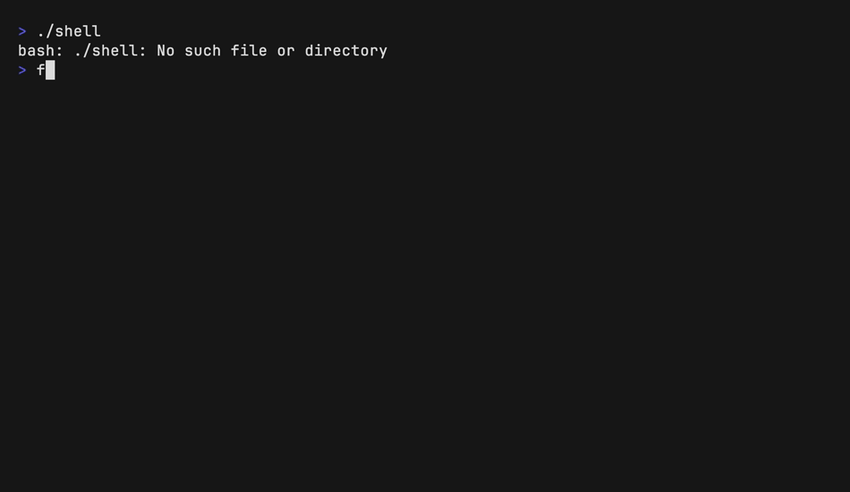

# `/posix-shell`

`a posix-style shell written from scratch in c++17`<br>
`process management, job control, parsing and expansion built on unix syscalls`<br>
`gnu readline is used only for line editing`



## `/features`

**`execution`**

`exec      : fork() · execvp()`<br>
`pipes     : ls | grep .cpp | wc -l`<br>
`redirect  : < · > · >> · 2> · 2>> · 2>&1`<br>
`chaining  : ; · && · ||`<br>
`quoting   : single · double · backslash`<br>
`exit code : 127 not found · 126 not executable`

**`expansion`**

`tilde     : ~ · ~/path`<br>
`variables : $VAR · $?`<br>
`globs     : * · ? via glob()`<br>
`aliases   : alias · unalias`

**`job control`**

`background : & · jobs · fg · bg`<br>
`signals    : ctrl+z suspends · ctrl+c kills the job, not the shell`<br>
`job refs   : fg %2`<br>
`groups     : setpgid · tcsetpgrp · termios restored after each job`<br>
`notify     : async done/suspended notices without breaking the prompt`<br>
`status     : 128+signal convention`

**`builtins`**

`cd (cd -, PWD/OLDPWD) · export · alias · unalias · jobs · fg · bg · exit · quit`

**`line editing`**

`readline : history · in-line editing`<br>
`complete : tab over builtins and $PATH`<br>
`prompt   : ~-relative dir · git branch (short hash if detached)`

## `/build`

`requires gnu readline (not the macos-default libedit)`

```sh
brew install readline
make        # builds ./mysh
make run    # builds and launches the shell
make clean  # removes build/ and the binary
```

`without make:`

```sh
clang++ -std=c++17 -g -O0 -Iinclude src/*.cpp -o mysh \
  -I$(brew --prefix readline)/include \
  -L$(brew --prefix readline)/lib -lreadline
```

## `/structure`

```
.
├── src/       # source files
├── include/   # headers
├── assets/    # demo gif
└── Makefile
```

## `/limitations`

`not implemented : $(...) · subshells · here-docs · brace expansion · ${VAR}`<br>
`                  if/for/while · script-file execution`<br>
`interactive use only`
